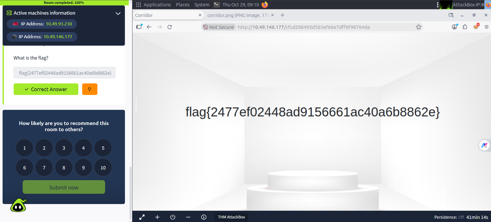

<div align="center">

# CRYPTONIX SYSTEMS

### Cybersecurity Research and Assessment

**Web Security Assessment: TryHackMe — Corridor**


**Prepared by:** Taslim Bano
**Assessment Date:** 29 October 2026

</div>

---

## 1. Project Overview

This repository documents my investigation of the TryHackMe Corridor room, a web security challenge focused on predictable URL references and hash-based identifiers.

I examined the application's HTML, extracted the available door references, and used Python and Linux command-line utilities to investigate how the hexadecimal URL values were generated.

By calculating MD5 hashes of numeric strings and comparing them against the extracted references, I identified a predictable relationship between numeric inputs and door paths. I then investigated the endpoint associated with the numeric input `0`, retrieved the challenge flag, and verified successful room completion.

The investigation gave me practical experience in endpoint analysis, hash investigation, browser developer tools, and evidence-based security reporting.

## 2. Assessment Details

| Attribute         | Details                                                |
| ----------------- | ------------------------------------------------------ |
| Organization      | Cryptonix Systems                                      |
| Assessment        | TryHackMe — Corridor                                   |
| Assessment Date   | 29 October 2026                                        |
| Platform          | TryHackMe AttackBox                                    |
| Tools             | Python 3, `hashlib`, `md5sum`, Firefox Developer Tools |
| Primary Technique | Hash analysis and URL reference manipulation           |
| Outcome           | Flag retrieved; room completion confirmed              |

## 3. Key Findings

### F-01 — Predictable Hash-Derived References

The extracted HTML contained 15 link references, including two external stylesheet URLs and 13 hash-like door references.

My Python comparison showed that candidate indices 1–13 matched the extracted door-reference set, while index 14 did not.

**Security relevance:** Predictable identifiers can make endpoint enumeration easier. Applications must not rely on identifier secrecy as a substitute for authorization.

[View hash extraction evidence](evidence/E03-extracted-door-hashes.png) · [View hash calculations](evidence/E04-md5-calculation-zero-and-one.png) · [View candidate comparison](evidence/E05-candidate-index-comparison.png)

### F-02 — Challenge Flag Retrieval

I calculated the MD5 hash of the numeric string `0`:

`cfcd208495d565ef66e7dff9f98764da`

I requested the corresponding endpoint and retrieved the challenge flag.

**Result:** The flag was accepted by TryHackMe, and the room reached 100% completion.




### F-03 — HTTP and Browser Inspection

I used Firefox Developer Tools to inspect HTTP responses and browser storage.

The observations included an HTTP `200 OK` response for a tested door endpoint, an HTTP `404 Not Found` response for `favicon.ico`, and no data displayed in the selected Storage panel.

These observations provide supporting context but do not independently establish a security vulnerability.

## 4. Investigation Workflow

The investigation followed these stages:

1. Inspected the initial Corridor interface.
2. Extracted URL references from the saved HTML.
3. Calculated MD5 hashes for candidate numeric inputs.
4. Compared the generated hashes against the extracted references.
5. Investigated the endpoint associated with `0`.
6. Retrieved the flag and verified room completion.
7. Documented the findings and supporting evidence.

## 5. Security Takeaway

**A hash is not an authorization mechanism.**

Hashing an identifier changes its representation but does not establish whether a user is permitted to access the corresponding resource.

Applications should enforce server-side object-level authorization for every protected resource request, regardless of whether the identifier is numeric, hashed, or randomly generated.

## 6. Full Assessment Report

The complete technical report contains the assessment methodology, detailed findings, evidence register, security recommendations, limitations, and conclusion.

**[Read the Full Corridor Security Assessment](report/corridor-security-assessment.md)**

## 7. Repository Structure

```text
cryptonix-corridor-assessment/
├── README.md
├── assets/
│   └── cybersecurity-banner.png
├── report/
│   └── corridor-security-assessment.md
└── evidence/
    ├── E01-initial-corridor-view.png
    ├── E02-corridor-target-browser.png
    ├── E03-extracted-door-hashes.png
    ├── E04-md5-calculation-zero-and-one.png
    ├── E05-candidate-index-comparison.png
    ├── E06-hash-zero-endpoint.png
    ├── E07-flag-retrieval.png
    ├── E08-network-favicon-404.png
    ├── E09-browser-storage-inspection.png
    ├── E10-network-door-request-details.png
    ├── E11-network-door-request-summary.png
    └── E12-room-completion-proof.png
```

## 8. Scope and Limitations

This repository documents the completed TryHackMe Corridor challenge. The findings are limited to the observed application behavior and the evidence collected during the assessment.

The broader major project includes additional exploitation phases involving web application exploitation, shell execution, Metasploit, and Linux privilege escalation. Those phases are not demonstrated in this assessment and are not claimed as completed.

## 9. References

* [TryHackMe](https://tryhackme.com/)
* [Python `hashlib` Documentation](https://docs.python.org/3/library/hashlib.html)
* [OWASP IDOR Prevention Cheat Sheet](https://cheatsheetseries.owasp.org/cheatsheets/Insecure_Direct_Object_Reference_Prevention_Cheat_Sheet.html)

---

<div align="center">

**CRYPTONIX SYSTEMS**

*Evidence-driven security research and practical cybersecurity learning.*

</div>
